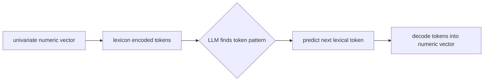
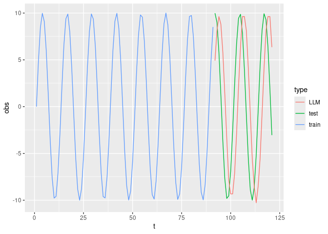
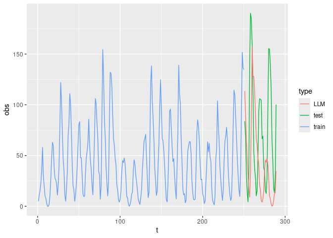

<!-- README.md is generated from README.Rmd. Please edit that file -->

# tense 

`tense` is an R package that uses a large language model to forecast any
univariate ordered numeric sequence (time series, spatial profiles,
simulation traces, etc.). It works by mapping numeric values to a fixed
sentiment lexicon (e.g., “excellent”, “solid”, “poor”, “dire”), feeding
the resulting word sequence to an LLM with a sliding context window, and
asking the model to continue the pattern. The output is a numeric
forecast by decoding sequences of sentiment words that describes the
predicted trajectory. The package provides `tense_init()`,
`tense_fit()`, `tense_predict()`.

note that LLMs are stochastic in nature. predicting univariate ordered
sequences using large language models via sentiment-encoded prompts will
return different results every time. The results will also be different
depending on the LLM used, temperature setpoint, & context window
length.

### tense flow diagram



## a tense example

``` r
library(tense)
library(ggplot2)
```

comparison of different models, temperatures, and context windows.
**Note that results will change every time the code is executed, even
with seeds set LLM results can vary.**

## sine wave:

``` r
t <- seq(0, 60, by = 0.5)
y <- sin(t) * 10
train <- y[1:(length(y) - 30)]
test <- y[(length(y) - 29):length(y)]

h <- length(test)
```

### LLM fit & infer

model

``` r
spec <- tense_init(
  model_name = "ollama/gemma3:4b",
  temperature = 0.85,
  seed = 14,
  top_k = 30,
  top_p = 0.75,
  context_window = length(train)
)

fit <- tense_fit(spec, train)
pred <- tense_predict(fit, h = h)
#> LLM Learning & Inferring ...
#> Predicted Lexicon: great, amazing, perfect, incredible, superb, acceptable

pred_df <- data.frame(
  pred = pred
) |>
  dplyr::mutate(t = dplyr::row_number() + length(train))
```

comparison:

``` r
data.frame(
  obs = y
) |>
  dplyr::mutate(
    t = dplyr::row_number(),
    type = ifelse(t > length(train), "test", "train")
  ) |>
  ggplot() +
  geom_line(aes(x = t, y = obs, color = type)) +
  geom_line(
    inherit.aes = FALSE,
    data = pred_df,
    aes(x = t, y = pred, color = "LLM")
  )
```



## sun spot time series:

``` r
# Load sunspot data (yearly sunspot numbers 1700-1988)
data <- as.numeric(sunspot.year)
n <- length(data) # 289 observations

train <- data[1:250] # First 250 years for training
test <- data[251:289] # Last 39 years for testing
h <- length(test)
```

### LLM fit & infer

``` r
spec <- tense_init(
  model_name = "google_gemini/gemini-2.5-flash-lite",
  # model_name = "mistral/mistral-medium",
  temperature = 0.1,
  seed = 5,
  top_k = 50,
  top_p = 0.5,
  context_window = length(train)
)

fit <- tense_fit(spec, sqrt(train))
pred <- tense_predict(fit, h = h, share_lexicon = TRUE)
#> LLM Learning & Inferring ...
#> Predicted Lexicon: divine, incredible, excellent, satisfactory, uncertain, bad

pred_df <- data.frame(
  pred = pred
) |>
  dplyr::mutate(t = dplyr::row_number() + length(train))

data.frame(
  obs = data
) |>
  dplyr::mutate(
    t = dplyr::row_number(),
    type = ifelse(t > length(train), "test", "train")
  ) |>
  ggplot() +
  geom_line(aes(x = t, y = obs, color = type)) +
  geom_line(
    inherit.aes = FALSE,
    data = pred_df,
    aes(x = t, y = pred^2, color = "LLM")
  )
```


